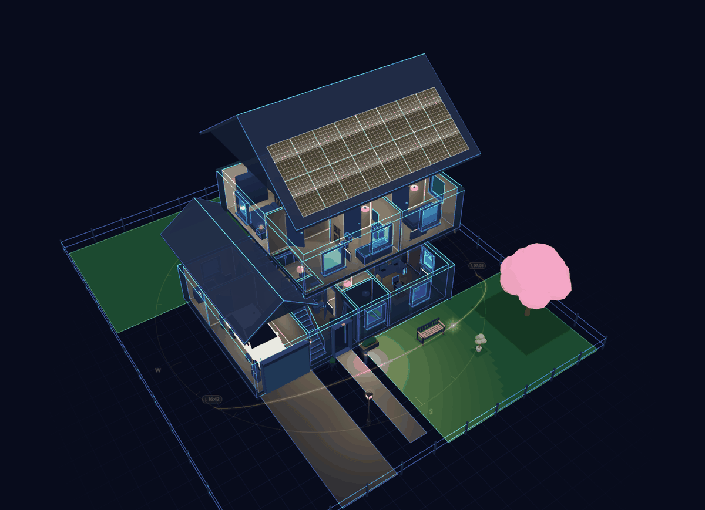
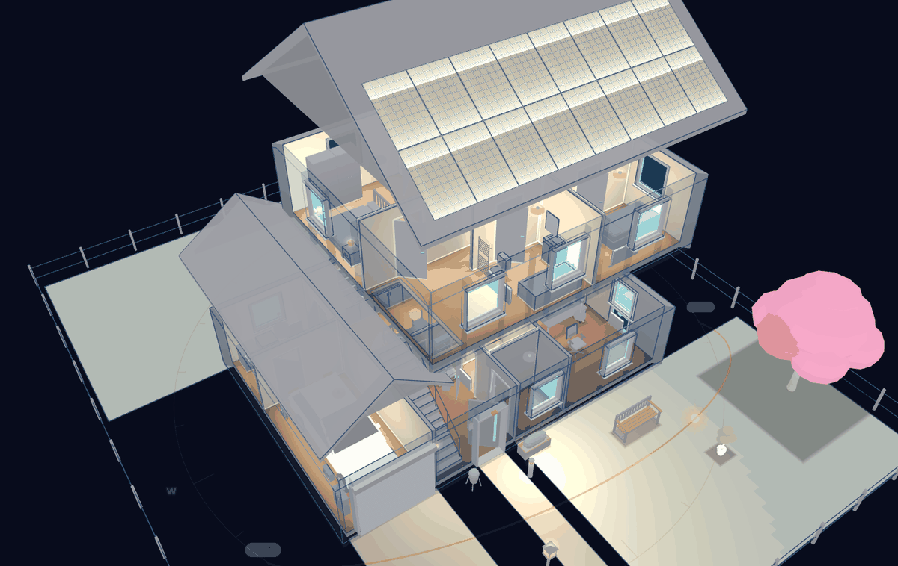
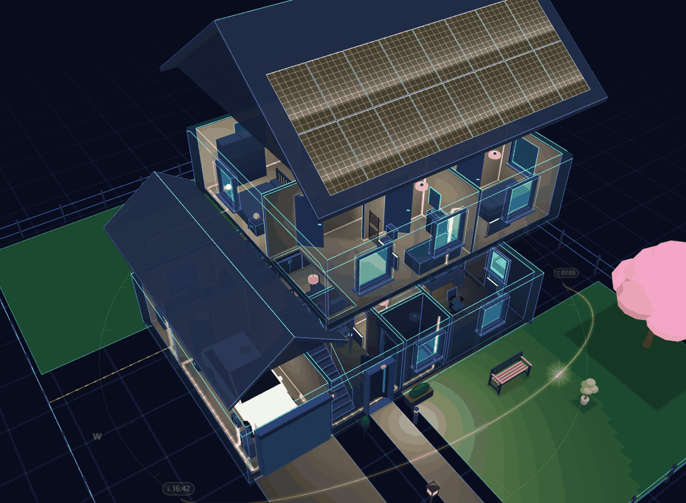
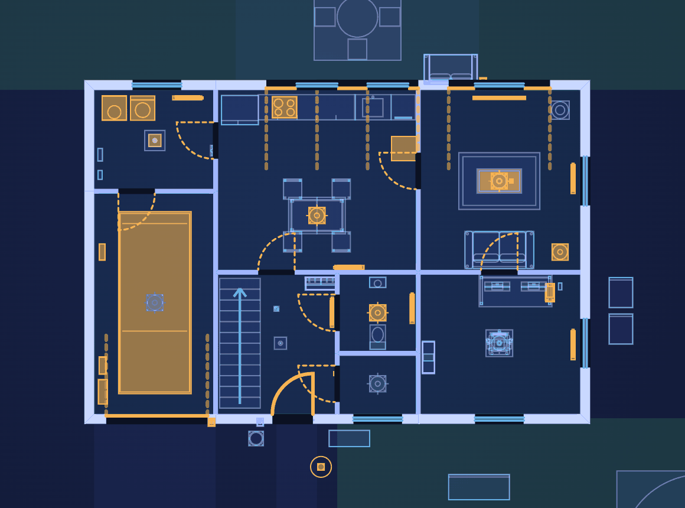

# Home 3D

Home 3D is a Home Assistant integration that lets you draw your home as a floor plan and control it in 3D. It adds a
sidebar panel with a plan editor and a live 3D view, plus a dashboard card (`custom:home-3d-card`).

- Plan editor inside Home Assistant: floors, rooms, walls, doors, windows, stairs, roofs, outdoor areas and solar fields.
- Live 3D view: lights, covers, doors, cameras, sensors and warnings shown in the room they belong to.
- Live room effects in 3D and 2D: a wet leak sensor turns its room's floor red until it is dry, motion lights the room
  for a short time (30 s by default), radiators and hot-water cylinders shade from cold blue to warm red with their
  temperature. Sensors are found from each room's area and placed devices; a room or item can name its own. Times
  and temperature ranges are in the ⚙ settings.
- Read-only 2D plan of the same building, for dashboards and wall tablets: device states, the same tap, hold and
  double-tap actions as in 3D, camera pictures from the plan. Switch with the 2D/3D buttons in the panel (or open it
  with `?view=2d`) and on the card.
- Furniture library with built-in models and furniture packs you can import yourself.
- Built-in extras: camera cockpit and motion trail, weather outside, live screens, energy view, sound, car,
  household, time travel and the fun extras.
- Restore points and a full backup of the plan, its pictures and the packs.

Home 3D is free and open source, made by [Amluto Solutions Ltd](https://home3d.amluto.com). Try the live demo on
[home3d.amluto.com](https://home3d.amluto.com) before you install it.

## Quick start

You need Home Assistant 2025.1 or newer, and an administrator account to install it.

1. Open *Settings → Marketplace* and choose **Add from link**.
2. Paste `https://github.com/amluto-solutions/home-3d`. The first time, the Marketplace asks you to connect GitHub
   with a device sign-in.
3. Install **Home 3D**. Accept the notice that community projects are not checked by the Home Assistant project.
4. Go to *Settings → Devices & services → Add integration → Home 3D*.
5. Open **Home 3D** in the sidebar.

Updates show under *Settings → Updates* and still need a restart.

To install by hand, copy `custom_components/home_3d` into your `config/custom_components/` folder, restart, and add
the integration under *Settings → Devices & services*.

To keep Home 3D out of the sidebar for everyone, open the integration's **Configure** and turn off **Show in sidebar**. This takes effect at once, and the panel link (`/home_3d`) and the dashboard card keep working. Each user can also hide the entry in Home Assistant's own sidebar settings.

### What it looks like









### Your first 10 minutes

Want to look around before you build? Open the home menu at the top and choose **Load the sample home**. It adds a small demo house with placeholder devices, and your own plan is left alone.

1. **Draw one floor (about 3 minutes).** Switch to **Editor**, then draw the outer walls and split them into rooms. Doors and windows go on the walls. Name each room. Press **?** to see the keyboard shortcuts and what the plan symbols mean.
2. **Add furniture (2 minutes).** Open the library, search for a sofa, a lamp or a radiator, and drop it in a room. The search understands UK and US words. Select an item to move, turn or resize it.
3. **Link a device (2 minutes).** Select a lamp, cover, sensor or camera and pick its Home Assistant entity in the item panel. Lights glow in 3D when they are on, and a tap toggles them.
4. **Look around (1 minute).** Switch back to the live view. Drag to orbit, scroll or pinch to zoom, tap an item to use it, and hold or double-tap for the item's other actions.
5. **Try the 2D plan and the dashboard card (2 minutes).** The **2D** button shows the flat plan, which suits a wall tablet (`?view=2d` opens it directly). To put the plan on a dashboard, add the card from the previous section.

Home 3D keeps restore points of the plan, so you can go back to an earlier version. It can also make a full backup of the plan, its pictures and the packs; take one before big changes.

A background or screen picture that only a restore point still uses is kept for 90 days after that restore point was made. Change the number of days under the integration's **Configure**. A restore point whose picture has gone restores without it and tells you so.

### Supported versions

- Home Assistant 2025.1.0 or newer (the same minimum is set in `hacs.json`).
- A browser with WebGL 2: current Chrome, Edge, Firefox, Safari, and the Home Assistant Companion app on Android and iOS.
- Only the 3D view needs WebGL. The 2D plan and the editor's plan drawing work without it.

### Tablets and phones

- **Wall tablets** should use the 2D plan or set the quality to **Tablet** (in the view settings, or `quality` on the card). Tablet is the lightest level. Moving decorations rest after 30 seconds without a touch, and shadows and weather are reduced. **Auto** picks it for Fire tablets it recognises, such as the Fire HD 10.
- **Locked tablet mode:** add `?tablet` to the panel address (for example in a kiosk browser's start URL) and the panel shows only the home name, the floors and the View menu: no editor, no view settings. `?tablet=0` turns it off again. You can also tick users for tablet mode in the settings. After a quiet spell the tablet returns to the whole house; `?idle=<seconds>` changes the wait and `?idle=0` disables it.
- **WebGL:** the 3D view needs hardware WebGL. If a tablet shows a blank 3D view, check that the browser is up to date and that hardware acceleration is on (Android System WebView and Fully Kiosk Browser use the system's WebView, so update that). Old or very cheap tablets can run out of graphics memory; use the 2D plan there.
- **Phones** can view and control the house. Drawing works best on a computer or a tablet.

## Dashboard card

The card is registered automatically. All options can be set in the card's visual editor; a minimal YAML example:

```yaml
type: custom:home-3d-card
height: 420
```

To start the card as the 2D plan, with a button to switch to 3D (a wall tablet, say):

```yaml
type: custom:home-3d-card
view: 2d
controls: [view]
```

## Privacy

The plan, its pictures and the furniture packs are stored in Home Assistant's `.storage`, and the frontend only talks
to your own Home Assistant. There is no account, no licence check, no shop and no usage reporting.

Only the optional furniture packs reach outside, and only to GitHub. Home Assistant (never your browser) asks
`api.github.com` and `raw.githubusercontent.com` when:

- an editor opens **Browse packs** in the library (the list is kept for six hours),
- you install a pack from a GitHub link,
- it checks packs you installed from GitHub for updates, once a day by default. Set this to never under
  **Extensions → Pack updates**.

The only other outside addresses Home 3D loads are ones you enter yourself, such as a background picture by URL.

### People and the room sensors

With locating on, Home 3D creates one room sensor per tracked device. Those sensors carry the room and the person, and every Home Assistant user can read them, so "Show people to admins only" only hides the figure in Home 3D: it does not protect the data. Households that want the room hidden for real can tick "Do not create a room sensor per person" in the locating setup (`person_sensors: false`): devices that belong to a person then get no sensor (and no figure), and sensors made earlier are removed. Things without a person, such as keys, keep theirs. The default is unchanged.

## Furniture packs

Home 3D comes with 14 packs of furniture inside the integration, so a new install needs no internet. More packs are
free and optional. You can get them in three ways:

- **Browse packs** in the editor's library lists the packs in
  [amluto-solutions/home-3d-packs](https://github.com/amluto-solutions/home-3d-packs) and community packs. Before
  anything installs, you see what it adds, changes and removes.
- **Extensions → Install from GitHub** takes the link of any public pack. Home Assistant fetches only the pack's data
  files, checks them, and installs the version you were shown.
- **Extensions → Import a pack folder** takes a folder you downloaded yourself. Nothing is fetched. Old single-file
  packs still import.

A pack is a folder of plain JSON: a `pack.json` that names the pack and its licence, and one file per item (see
[docs/packs.md](docs/packs.md)). Packs are data only, with no code, pictures or links, and Home Assistant checks every
file on import. `python tools/fp3dpack.py validate <folder>` checks a pack before you import or publish it. A new pack
release changes nothing in your house until you update the items; auto-update is off by default.

Racks, rack-mount gear, links to Home Assistant, the rack card and voice questions are in [docs/racks.md](docs/racks.md).

## Development

```bash
cd frontend
npm ci
npm test
npm run typecheck
npm run build   # writes the bundles to custom_components/home_3d/frontend (committed)
```

Python tests use `pytest-homeassistant-custom-component` (`pip install -r requirements_test.txt`, then `pytest`).
Home Assistant does not run on Windows; use Linux, WSL or CI for the Python tests.

## Licence

MIT, see [LICENSE](LICENSE). The bundled fonts are under the SIL Open Font License (licence files next to the fonts).
Home 3D began as a copy of [NeonPlan 3D](https://github.com/Mastershort/neonplan3d) by Mastershort (MIT), and is not
affiliated with it; see [NOTICE](NOTICE).

## Support

Home 3D is free and stays free. If it is useful to you, [buy Amluto a coffee](https://buymeacoffee.com/amluto). Report
problems in [the issue tracker](https://github.com/amluto-solutions/home-3d/issues).
