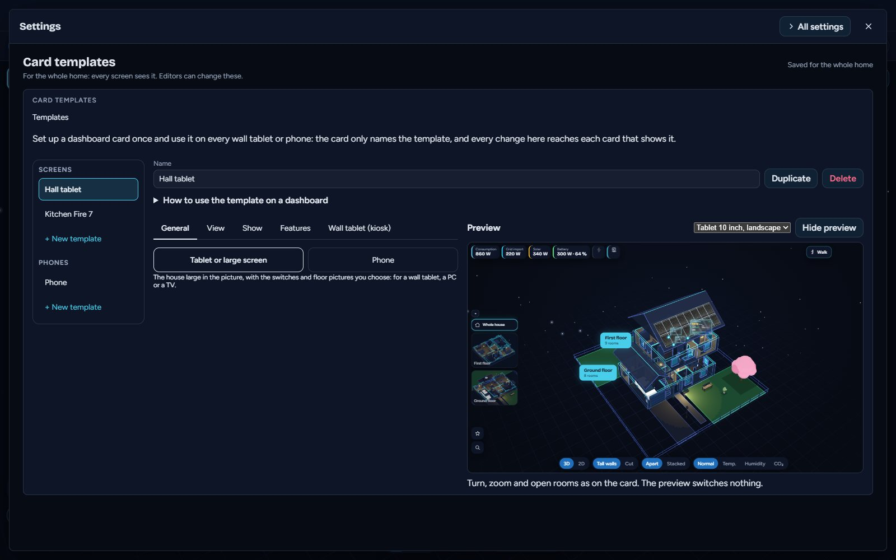

# Card options and templates

The dashboard card (`custom:home-3d-card`) takes its options from the card form or from YAML. This page lists the
options that came with Home 3D 1.8.0. The older options are in the [README](../README.md#dashboard-card).

## Options

| Option | Meaning |
|---|---|
| `surroundings: false` | Draws the house on this card without the neighbourhood from the map. The plan keeps the map, and the OpenStreetMap credit leaves the card too. The card form has the switch under **Show**, and only when the plan has a map. |
| `rooms: [kitchen, lounge]` | Shows only these rooms and outdoor areas, by id. See [Rooms on their own](#rooms-on-their-own). |
| `phone: true` | Uses the [phone view](phone-view.md) on this card. |
| `phone_hide`, `phone_start`, `phone_places` | Parts of the phone bar. See [Phone view](phone-view.md#places-of-your-own). |
| `phone_solo: true` | A room you jump into stands alone in the picture. See below. |
| `template: <id>` | Takes the options from a card template. See [Card templates](#card-templates). |
| `view_only: true` | The card only looks, for a wall tablet: it shows everything and switches nothing. See [View only](#view-only). |
| `floor_tabs: true` / `false` | How the card switches floors. Without the option, a card as narrow as a phone (600 px or less) shows the floors as tabs at the top left: **Whole house** first, then each floor from the top down. A wider card shows the small floor pictures at the side, as before. `true` shows tabs at every size, and `false` keeps the pictures on a phone too. With tabs, the name boxes of the floors over the house are left out. When the full names do not fit, the tabs show short names: **House** for the whole house, and each floor without the word that all floor names share at the end or the start (Top floor, First floor and Ground floor become **Top**, **First** and **Ground**). Screen readers still get the full names, and a floor whose short name would be empty or read like another tab keeps its full name. A row of tabs still too long for the card scrolls sideways and fades out at the end that has more. The card form has the choice under **Show**, below **Floor switcher**. A card that has no floor switcher (`floor_thumbs: false`, a start floor without the switcher, `rooms`) and the phone view are not changed. |

Which icons and floating cards show is not a card option: it is a rule of the item, the same on every card and screen
(see [Show and hide rules](show-and-hide.md)). Any dashboard card's floating cards can be
[shown larger](card-zoom.md).

## View only

With `view_only: true` (in the card form: **View only**) the card shows the house with its states, turns, zooms, opens
rooms and follows links, but a touch switches nothing. The card sends no service call and saves nothing in the plan.
The room panel shows its controls locked, and the quick menus, the all-off button, scenes, swipe dimming and the
microphone are left out. Home Assistant's own details window is not part of the card: a long press still opens it, and
you can switch there. It is a guard against a touch by accident, not a permission: for that, use a Home Assistant user
with fewer rights.

## Rooms on their own

`rooms` shows only the rooms and outdoor areas in the list, with their furniture, devices, doors and windows. The other
rooms, the floors, the roof, the map and the floor pictures are left out. The devices of the hidden rooms are still read,
so counts and warnings stay right. When the list holds one room, the card opens it with its panel.

A wall that a hidden room shares keeps the thickness of an inner wall, and the door of the neighbour stays in it. Our flat
and gable roofs have no frame that keeps the whole footprint, so the roof is left out while rooms stand alone.

On a phone, **More → Room on its own** does the same for the room you jump into. Each device chooses for itself. Until a
device has chosen, the card option `phone_solo: true` decides. The card form has the switch in its phone section.

## Card templates

A card template is a card that you set up once and use on many cards. Use it when several wall tablets or phones must
look the same. The card only names the template:

```yaml
type: custom:home-3d-card
template: hall_tablet
```

Every change to the template reaches each card that uses it, and no reload is needed. An option written in the card's
own YAML wins over the template, so one tablet can differ in one thing. The template is kept in the plan, so a backup
holds it.



### The page

Open **Settings → Card templates**. The page has these parts:

- A list of templates by kind: **Screens** (tablets and large screens) and **Phones**. Each list ends with
  **+ New template**.
- The name of the chosen template. When you change the name, the id follows it, and the old id still works for the cards
  that use it. **Duplicate** copies the template. **Delete** removes it.
- **How to use the template on a dashboard** (folded) shows the YAML to copy.
- The card form in tabs: General, View, Show, Features and Wall tablet.
- A preview beside the form, on a screen you choose (a phone template shows on a phone). The preview turns, zooms and
  opens rooms as the card does, but it calls no service and saves nothing.

The first question on the General tab is what the card is for. A **Tablet or large screen** card has the switches and
floor switcher you choose. A **Phone** card fills the screen and has the options of the phone bar under General. It has
no kiosk options, switches or floor switcher.

A plan holds up to 30 templates.

### On a dashboard

In the card form of a dashboard, a choice of template stands on top. When you choose one, the form folds away, because
the template holds the options.

## Where templates are stored

Templates are stored in the plan under the optional key `card_templates`. See
[plan-format.md](plan-format.md#card-templates).
