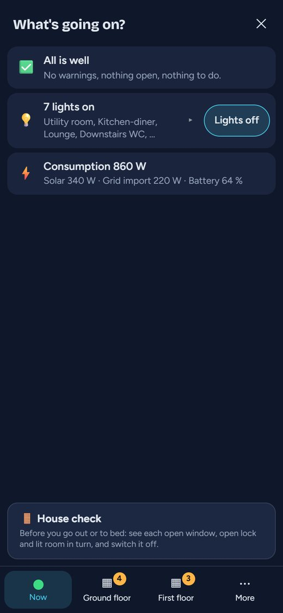
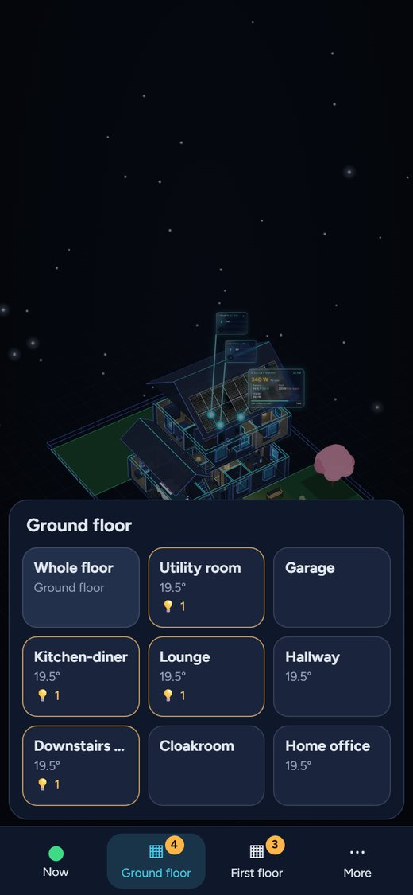
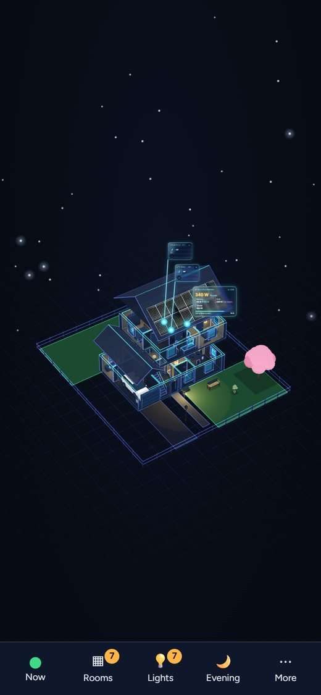

# Phone view

The phone view is a layout of its own for a small screen. The header, the floor bar and the loose buttons make way
for one bar at the bottom of the screen, within reach of the thumb. The house stays in the picture above it.



## Switching it on

- **On a device:** the first time Home 3D opens on a phone, it asks once whether to use the phone view. You can change
  the answer in **Settings → Screen and controls → Phone view**. The setting belongs to that device.
- **On a dashboard card:** set `phone: true`, or use a [card template](card-options.md#card-templates) made for a
  phone. A phone card fills the screen, so put it on a view of its own in panel mode.

The phone view is off by default. It does not change the tablet or desktop layout.

## The bar

The bar has up to five places. Tap a place to open its page over the house.

| Place | What it shows |
|---|---|
| **Now** | The list "What's going on?" (see below). |
| **Rooms** | The rooms of a floor as tiles, with the temperature, the lights that are on, open windows and music. A house with two floors gets a place for each floor. A house with more floors gets one place, "Rooms". Tap a tile to fly into that room. |
| **Blinds** | Every blind of the house: all up or all down, and each one on its own. |
| **More** | Search, the house check, the whole house and, in the panel, View, cameras, time travel, Settings and the menu of Home Assistant. |

A room's panel opens folded on a phone, so you see the room first. The bar keeps clear of the phone's home bar (the
safe area).



### Now: "What's going on?"

The list puts what needs attention first:

1. warnings (smoke, water, alarm);
2. open windows and doors, and open locks;
3. who is home and the household;
4. lights, cars and energy.

When nothing needs attention, the list says "All is well". A tap on a line flies to that place. Some lines have a
button: **Lights off** switches off the lights that are on, and **Lock** locks a lock.

### House check

The house check is on the list and in More. Use it before you go out or to bed. It steps through each open window, each
open lock and each lit room in turn. You close, lock or switch off the item, or go on to the next one.

## Places of your own

A card can add up to two places of its own to the bar. Set them in the card form under **The bar on the phone**, or in
YAML:

```yaml
type: custom:home-3d-card
phone: true
phone_places:
  - kind: lights
  - kind: action
    name: Evening
    icon: 🌙
    entity: scene.evening
```



| `kind` | What it does | Other keys |
|---|---|---|
| `lights` | Opens a page with the lamps of the house by floor: all on, all off, and each lamp. The number on the place is the number of lamps that are on. | |
| `climate` | Opens a page with the thermostats of the house by floor. | |
| `action` | Runs a scene, script, button or automation. | `entity` (required) |
| `link` | Opens a page inside Home Assistant. | `path`, for example `/lovelace/energy` (required) |

Each place can have its own word under the symbol (`name`, up to 24 characters) and its own symbol (`icon`, an emoji or
a short sign). A `link` goes only to a path inside Home Assistant, never to another site. A place with nothing to show,
such as Lights in a house with no lamps, stays away.

### Favourites

The favourites of the house (**Settings → Favourites and buttons**) stand as big buttons on top of "What's going on?".

### Leaving parts out, and starting with the list

```yaml
phone_hide: [rooms, covers, favorites]   # leave out the rooms, the blinds or the favourites
phone_start: now                         # open with the list instead of the house
```

Both options are in the card form under **The bar on the phone**.

## Links for notifications

A link into Home 3D can open a place at once. This is useful in the notification of an automation: a tap on the
notification lands in the right place. The links work on `/home_3d`, the address of the panel.

| Link | Result |
|---|---|
| `/home_3d?view=now` | Opens the list "What's going on?". It also works on a device that has not switched the phone view on, for that visit only. |
| `/home_3d?room=kitchen` | Opens a room. Use the name or the id of the room. |
| `/home_3d?show=binary_sensor.back_door` | Flies to the device that has this entity. |

```yaml
action: notify.mobile_app_my_phone
data:
  message: The back door is open.
  data:
    url: /home_3d?show=binary_sensor.back_door
```
