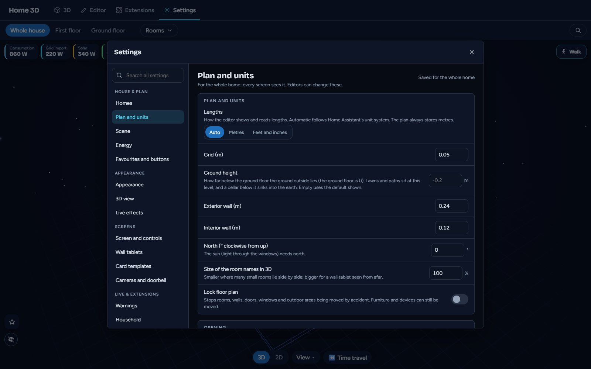
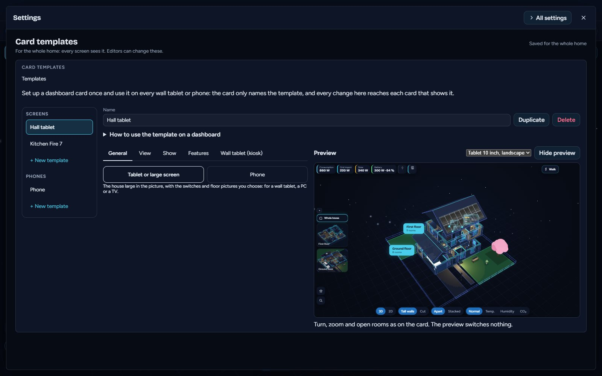

# Settings

Settings opens as one compact dialog over the page you came from. The 3D view, the editor or Extensions stay as they
were behind it. When you close the dialog, you are back where you were.



## The five groups

The topics are on the left, in five groups. The topic you choose is on the right. The dialog keeps its size from one
topic to the next.

| Group | Topics |
|---|---|
| **House & plan** | Homes, Plan and units, Scene, Energy, Favourites and buttons |
| **Appearance** | Appearance, 3D view, Live effects |
| **Screens** | Screen and controls, Wall tablets, Card templates, Cameras and doorbell |
| **Live & extensions** | Warnings, Household, People, Voice, Pack updates |
| **System** | Who can edit, Backup, Advanced |

Each topic says at the top who its settings affect: the whole home, or this device only. The old switch between "This home"
and "This device" is gone. The topics of both sides are in the one list.

## Search

Type in the search box to find a setting by its name. Use the arrow keys to move, **Enter** to open a result and
**Escape** to close the dialog. A result opens its topic and marks the setting. A link can open a topic or a setting
directly:

```
#settings/<topic>/<setting>
```

## Closing

Press **Escape** or the close button ("Back to 3D" or "Back to Editor"). While the dialog is open, no key reaches the plan
behind it.

## Card templates take the whole width

[Card templates](card-options.md#card-templates) need room for the form and the preview. The topic uses the whole width of
the dialog, and the list of topics folds away. **All settings** brings the list back.



## Narrow windows

In a narrow window the topics become a choice under the search box.

## Surroundings: gable roofs for the neighbours

**Settings → Scene → Surroundings → Neighbours' houses with a gable roof** gives the houses from the map a simple gable
roof. The ridge runs along the longer side of the house, and the height from the map is the height of the ridge. The
setting is off by default. Halls, blocks of flats and winding buildings stay blocks. The setting does nothing while the
neighbours are drawn as flat outlines. It is stored as the optional key `roofs` in the surroundings (see
[plan-format.md](plan-format.md)).
